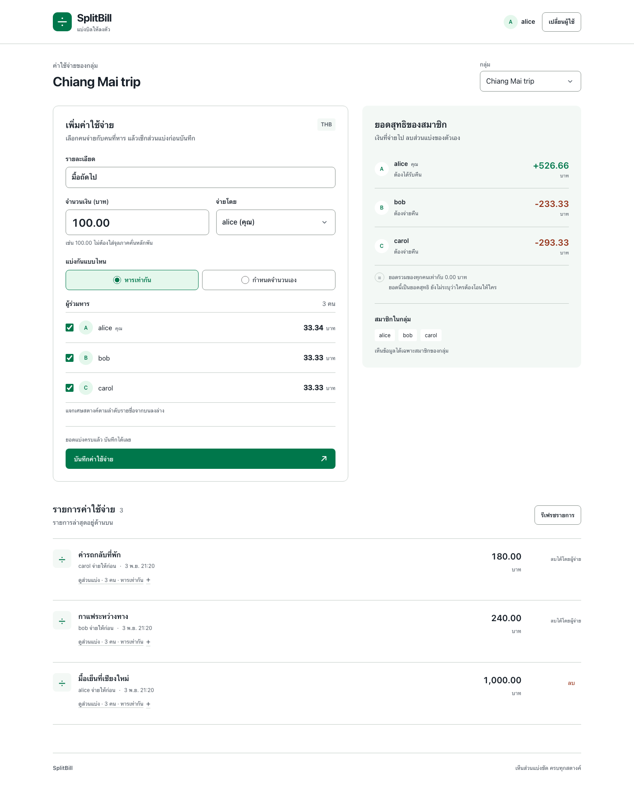
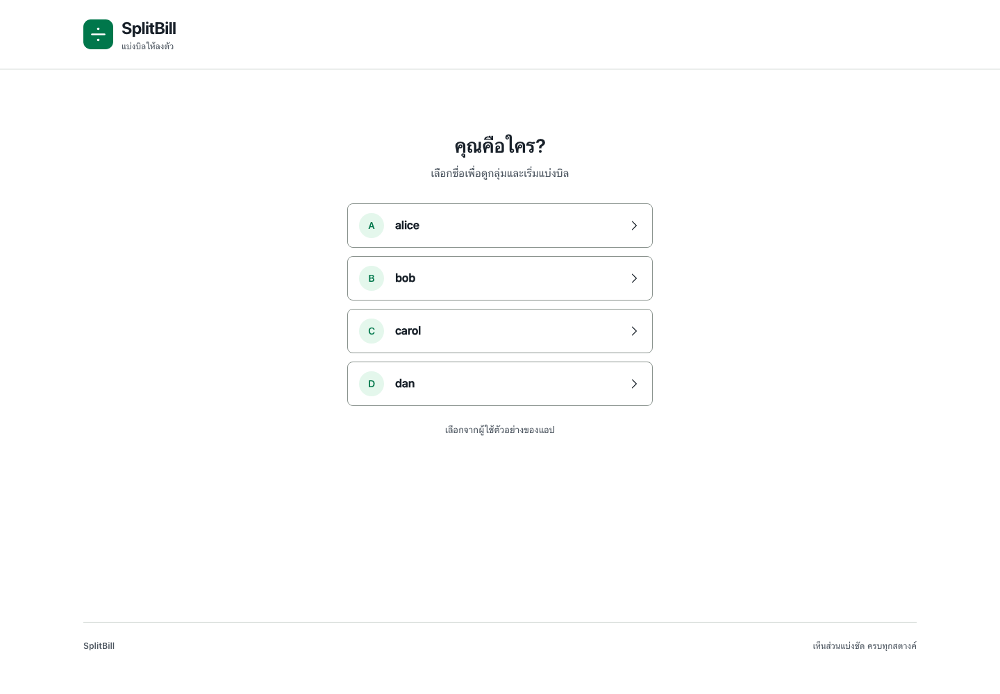

# SplitBill design references

The owner approved the direction in [DESIGN.md](../DESIGN.md): a friendly, readable Thai interface, white working surfaces, green primary actions, exact monetary previews, and a responsive single-page expense workflow.

The approved profile-entry update replaces the header's user dropdown with four vertical choices before entering, then the current name and “เปลี่ยนผู้ใช้” in the workspace. It retains the same palette, self-hosted font, and division-mark SVG.

## Sources

- [SplitBill Thai Design System in Stitch](https://stitch.withgoogle.com/projects/16468469070349900352) was created before frontend implementation on 2026-11-03.
- [PRODUCT.md](../PRODUCT.md) records product context and the owner's confirmed personality.
- [DESIGN.md](../DESIGN.md) is the reviewed visual specification; [the frontend plan](../docs/frontend-plan.md) defines interaction and integration behavior.
- `ui-ux-pro-max` informed Thai typography, form usability, keyboard access, readable contrast, and responsive checks. `impeccable` governs the interface quality; `ponytail` keeps implementation dependencies and abstractions small.
- Noto Sans Thai comes from [Google Fonts](https://github.com/google/fonts/tree/main/ofl/notosansthai); its [OFL license](../frontend/app/fonts/OFL.txt) accompanies the self-hosted font. The [division mark SVG](../frontend/app/icon.svg) is shared by the header and favicon, so its alignment does not depend on font metrics. The header renders it at 43px on desktop and 36px on mobile.

## Review of the generated reference

The first Stitch specimen contained incorrect business rules and features that are not implemented by the backend. The reviewed design corrects them:

- Remainder satang follows submitted participant order, independently of the payer.
- Balances are net amounts per member; they do not establish bilateral transfers or prove that a payment occurred.
- Available groups and memberships come from the API.
- PromptPay, QR codes, payment requests, receipt uploads, and settlement actions are outside this interface.

A corrective prompt was submitted to Stitch. The last verified response reported that corrections were being applied. Browser control was unavailable during the later asset pass, so the corrected Stitch board and a source screenshot/export could not be independently captured. No local image should be represented as a Stitch export unless its provenance is recorded here.

## Application screenshots

Screenshots added to this directory from the implemented frontend are examples of the running application, distinct from the original Stitch specimen. Their filenames, capture conditions, and any limitations should be recorded alongside them. They illustrate appearance and do not replace automated checks or real backend/PostgreSQL integration evidence.

| File | Capture |
| --- | --- |
| [frontend-desktop.png](frontend-desktop.png) | Chromium, 1440px viewport, full page |
| [frontend-mobile.png](frontend-mobile.png) | Chromium, 390px viewport, full page |
| [frontend-entry-desktop.png](frontend-entry-desktop.png) | Chromium, 1440px viewport, profile entry |
| [frontend-entry-mobile.png](frontend-entry-mobile.png) | Chromium, 390px viewport, profile entry |

These four images were captured on 2026-11-03 by [the integration runner](../scripts/test-frontend-integration.py) during the passing profile-entry run, using the production Next build, real FastAPI endpoints, and a disposable PostgreSQL 16.13 test schema. Fonts and finite transitions finished before capture. The entry images show the initial chooser before profile selection or API reads. The workspace images replace the earlier captures and show example dinner1000.00, coffee240.00, and taxi180.00 expenses created through the real API in that isolated schema. The form previews a separate, unsaved100.00 bill; that draft is not included in the displayed balances. The schema and owned test processes were removed after the run; no application transactions appear in these images.

The same runner checks page overflow at 375/390/768/1024/1440px and reduced motion. This is Chromium evidence, not a claim of testing every browser or every device. These files are application screenshots, not Stitch exports.

## Header logo alignment

The header uses the same SVG as the favicon rather than a font glyph, keeping the division mark centered at both sizes. These crops were captured from the running development app on 2026-11-03 after the image and fonts loaded: [desktop, 1440px viewport](logo-desktop.png) and [mobile, 390px viewport](logo-mobile.png). They show the header only and do not replace the full-stack screenshots above.

## Profile-entry references

The owner compared two Imagegen direction probes and selected the vertical direct-entry list. Those generated images are design references, not screenshots of the application. The implementation uses native buttons and the existing SVG logo; generated texture and text-rendering artifacts are not part of the design.

The entry images in the table above are actual application captures from the passing 13-group browser run. The header-only logo crops retain their earlier capture conditions and document the shared SVG mark rather than the new entry interaction.

