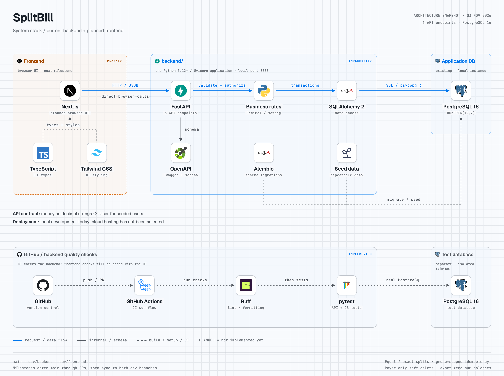

# SplitBill: stack และเส้นทางข้อมูล

ภาพนี้แสดง backend ที่มีอยู่ใน repository และ frontend ตาม brief ซึ่งยังไม่ได้พัฒนา เส้นทางจาก browser ไป API เป็นแผนสำหรับการเชื่อมต่อในขั้น frontend

- [เปิดแผนภาพ HTML](stack.html)
- [ภาพ PNG พื้นสว่าง](stack.png) · [ภาพ PNG พื้นมืด](stack-dark.png)

## เทคโนโลยีและสถานะ

| ส่วน | เทคโนโลยี | หน้าที่ | สถานะ |
| --- | --- | --- | --- |
| Frontend | Next.js + TypeScript + Tailwind CSS | UI เลือกผู้ใช้/กลุ่ม แสดงรายจ่ายและยอดคงเหลือ สร้างและลบรายจ่าย | ตาม brief; ยังไม่ได้พัฒนา |
| HTTP API | FastAPI + Uvicorn, Python 3.12+ | รับ HTTP/JSON ตรวจข้อมูลและสิทธิ์ แล้วส่งผลลัพธ์ JSON | มีแล้ว: 6 endpoints |
| Business services | Python `Decimal` และจำนวนเต็มหน่วยสตางค์ | ตรวจสมาชิก แบ่งเงินแบบ equal/exact, idempotency และสิทธิ์ลบของผู้จ่าย | มีแล้ว |
| Data access | SQLAlchemy 2 + psycopg 3 | จัดการ session/transaction และ query PostgreSQL | มีแล้ว |
| Application database | PostgreSQL 16 | เก็บ users, groups, memberships, expenses และ shares; จำนวนเงินใช้ `NUMERIC(12,2)` | มีแล้ว |
| Schema และข้อมูลเริ่มต้น | Alembic + Python seed | อัปเกรดโครงสร้างฐานข้อมูลและสร้างข้อมูลตัวอย่างแบบรันซ้ำได้ | มีแล้ว; รันระหว่าง setup |
| API contract | OpenAPI + [API contract](../api-contract.md) | อธิบาย request/response/error เพื่อส่งต่องาน frontend | มีแล้ว: [schema ที่สร้างจาก API](../openapi.json) |
| Backend checks | pytest + Ruff + GitHub Actions | ตรวจพฤติกรรม lint/format, OpenAPI, migration และ seed กับ PostgreSQL 16 | ตั้งค่าแล้ว |
| Test database | PostgreSQL 16 แยกจาก application database | รองรับ integration tests; fixtures สร้าง schema ชั่วคราวแยกแต่ละรอบ | มีแล้ว |

## เส้นทาง request

1. **รอพัฒนา frontend:** browser ที่รัน UI ส่ง HTTP/JSON ตรงไป FastAPI; กำหนด origin ที่อนุญาตผ่าน `CORS_ORIGINS` ของ backend การเชื่อมต่อจริงจาก browser ยังรอการตรวจสอบในขั้น frontend
2. Uvicorn รับ request ให้ FastAPI ตรวจ schema และอ่าน `X-User` เพื่อเลือกผู้ใช้ตัวอย่าง จากนั้น services ตรวจสิทธิ์สมาชิกของกลุ่มและกฎธุรกิจ
3. Services ตรวจเงินด้วย `Decimal`; equal split คำนวณเป็นจำนวนเต็มหน่วยสตางค์และแจกเศษตามลำดับสมาชิก ส่วน exact split ต้องรวมเท่าจำนวนเงินของบิล
4. Repositories ใช้ SQLAlchemy และ psycopg ติดต่อ application database รายจ่ายและ shares บันทึกใน transaction เดียว; idempotency key มีขอบเขตต่อกลุ่ม และ soft delete เก็บแถวเดิมไว้
5. API ส่งจำนวนเงินกลับเป็น string ทศนิยมสองตำแหน่ง ยอดคงเหลือรวมจากเงินที่จ่ายลบด้วยส่วนแบ่งใน PostgreSQL โดยไม่รวมรายจ่ายที่ลบแล้ว

Alembic และ seed เป็นคำสั่ง setup ที่ติดต่อฐานข้อมูลโดยตรง แยกจากเส้นทาง request ปกติ ส่วน pytest ใช้ `TEST_DATABASE_URL` ของฐานทดสอบแยกต่างหาก ไม่ใช้ application database

`X-User` เป็นข้อตกลงสำหรับ assessment เพื่อเลือก seeded user การยืนยันตัวตนแบบ production ยังอยู่นอกขอบเขตนี้ ยังไม่ได้เลือก cloud vendor หรือ deployment target

## การตรวจสอบและส่งต่องาน

[GitHub Actions](../../.github/workflows/backend.yml) รัน backend checks เมื่อ push ไป `main`, `dev/backend`, `dev/frontend` และเมื่อเปิด PR เข้า `main` ผลของแต่ละ run ต้องตรวจจาก revision ที่ส่งมอบ; แผนภาพไม่ได้รับรองผล CI หรือการ deploy

[Workflow สาม branch](../git-workflow.md) ใช้ `main` เป็นฐานส่งต่องานที่ยอมรับแล้ว, `dev/backend` สำหรับ backend และ `dev/frontend` สำหรับ frontend โดยส่ง milestone ผ่าน PR เข้า `main` แล้ว sync กลับทั้งสอง dev branches การตั้งค่า workflow นี้ไม่ได้ยืนยันว่ามี branch protection บน server

งานที่ยังเหลือคือสร้าง frontend ตาม brief ให้ preview และจัดการเงินตรงกับ backend แล้วตรวจ integration ผ่าน browser กับ API จริง โดยใช้ revision ที่ส่งมอบและ OpenAPI snapshot ที่ตรงกัน ดูวิธีติดตั้งและรัน checks ใน [README หลัก](../../README.md)

## ไฟล์แผนภาพ

`stack.html` เป็นไฟล์ต้นฉบับที่ฝังโลโก้และฟอนต์ไว้แล้ว จึงเปิด offline และสลับธีมได้ ภาพ PNG ทั้งสองธีม export จาก HTML เดียวกันด้วย headless Chromium ที่ความละเอียด 2 เท่า หากแก้ผัง ให้ render ภาพใหม่จาก HTML เพื่อให้ README และภาพที่ส่งต่อสอดคล้องกัน

ดูแหล่งโลโก้และสิทธิ์การใช้งาน template/ฟอนต์ใน [NOTICE.txt](NOTICE.txt) โดย Alembic ใช้เครื่องหมายของโครงการ SQLAlchemy ซึ่งเป็นโครงการเจ้าของ migration tool นี้
